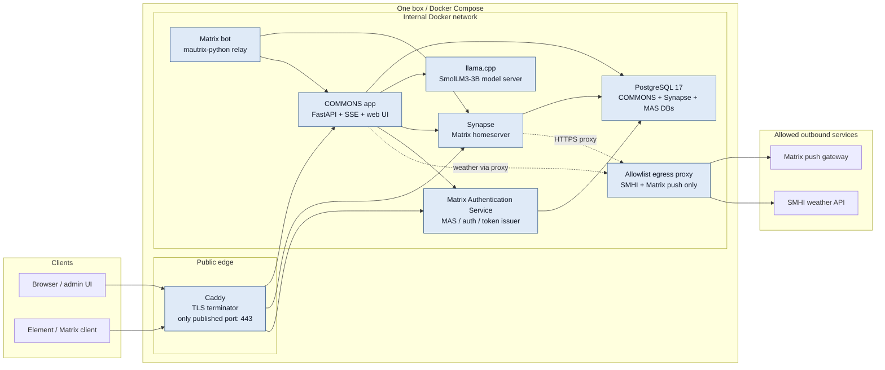

# Network components and services in use now

This diagram reflects the current stack defined in `docker-compose.yml` and the repo documentation.

## Notes

- Only Caddy exposes a host port; all other services stay on the Docker `internal` network.
- `bot` and `llm` are not directly reachable from the LAN.
- `egress` is the only outbound route for approved traffic (Matrix push and SMHI weather). Everything else stays internal.
- `app` talks to `matrix`, `mas`, `postgres`, and `llm` over Docker service names such as `http://matrix:8008`, `http://mas:8080`, and `http://llm:8080`.
- Secrets and runtime credentials are mounted from `./secrets` and never passed as plain environment variables.
